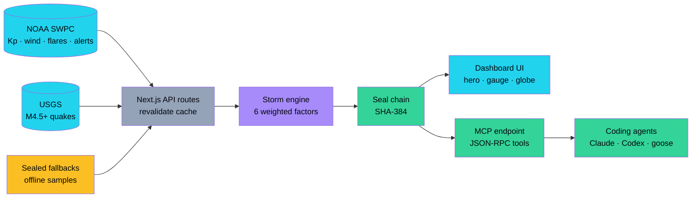
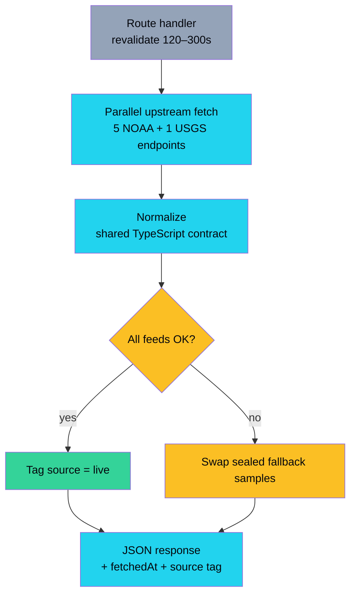
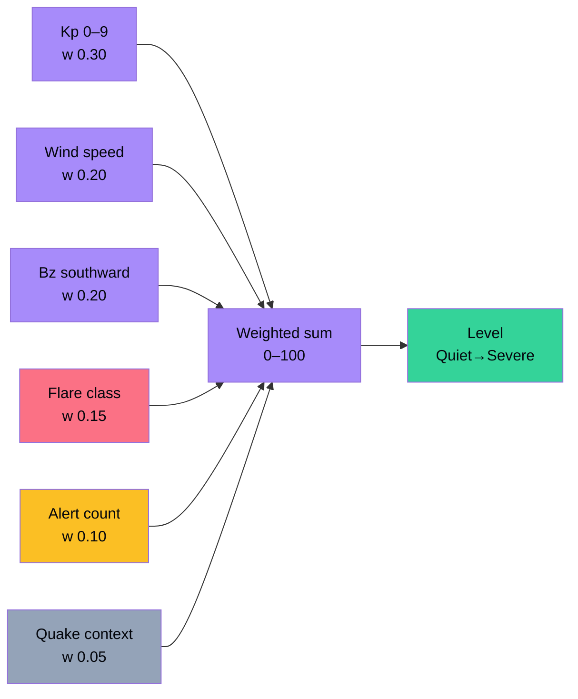
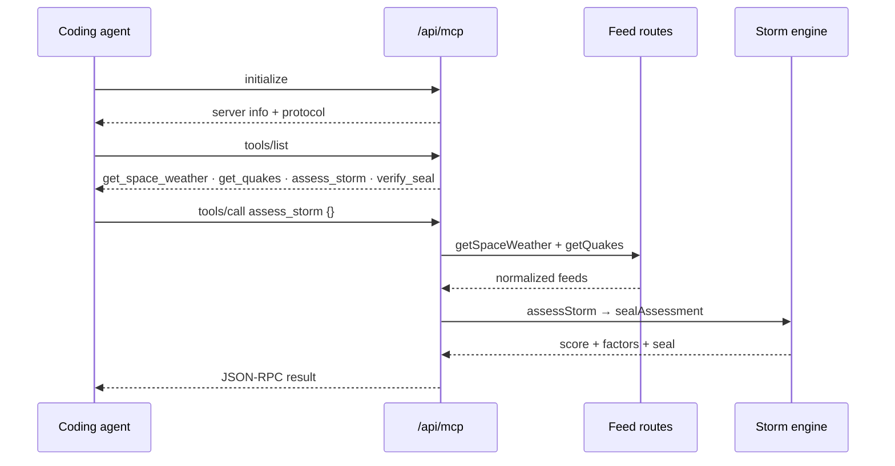
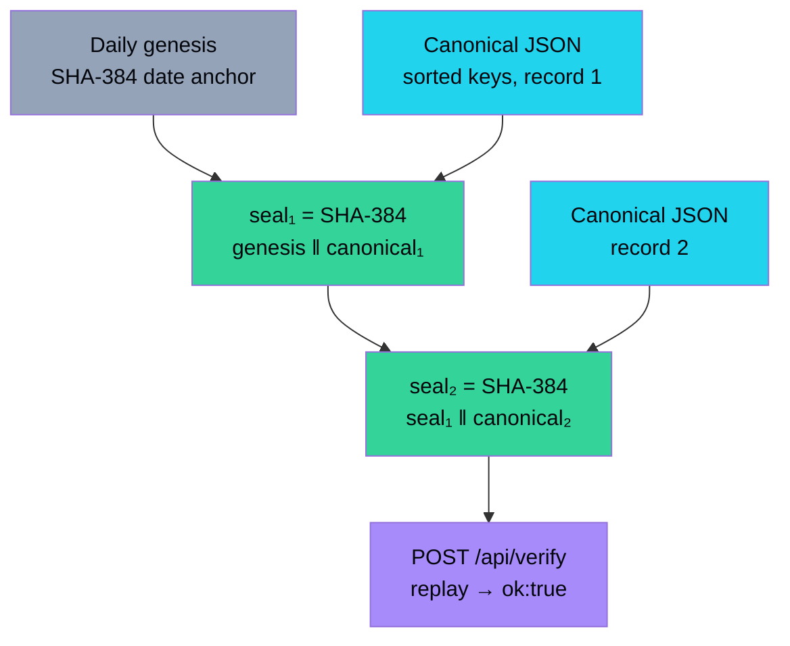
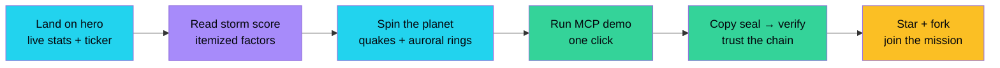
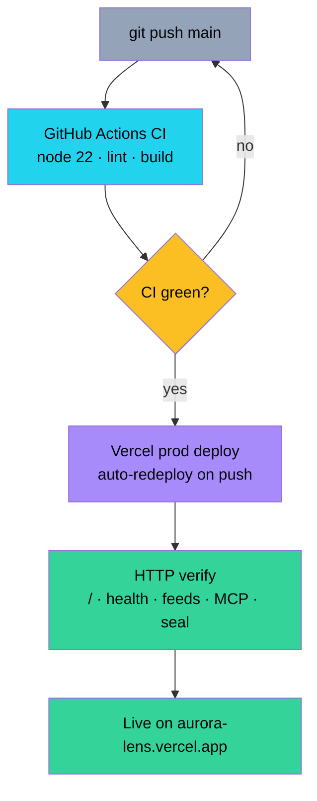
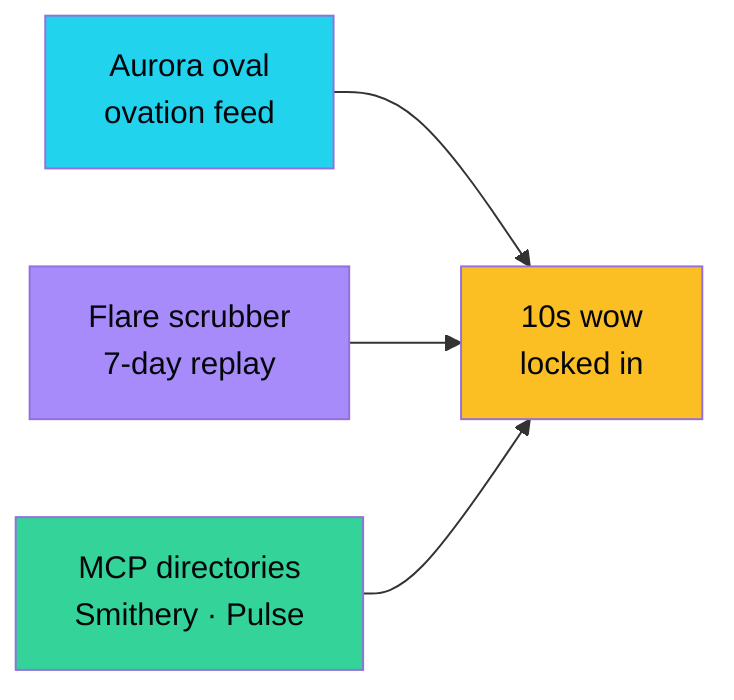
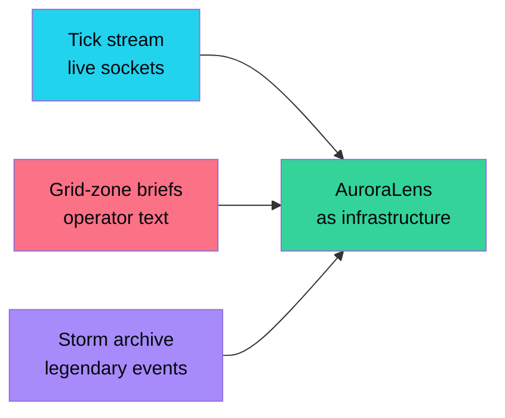
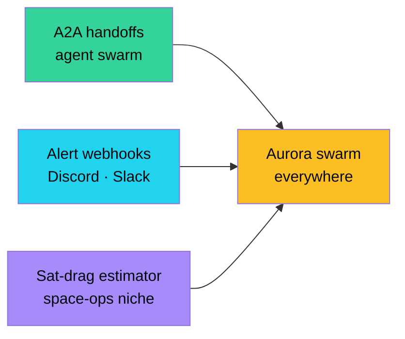

<div align="center">

# 🌌 AuroraLens

**The Sun is shouting. AuroraLens listens — live solar-storm + seismic ops on a 3D planet, for humans *and* agents.**

[](https://aurora-lens-ruddy.vercel.app)
[](./LICENSE)
[](https://nextjs.org)
[](https://aurora-lens-ruddy.vercel.app/api/health)
[](https://aurora-lens-ruddy.vercel.app/api/mcp)
[](https://github.com/aniruddhaadak80/aurora-lens/actions)

[Live App](https://aurora-lens-ruddy.vercel.app) · [API](https://aurora-lens-ruddy.vercel.app/api/health) · [MCP](https://aurora-lens-ruddy.vercel.app/api/mcp) · [Issues](https://github.com/aniruddhaadak80/aurora-lens/issues)

</div>

> ⚠️ **Safety note:** AuroraLens is an educational dashboard, not an operational warning
> system. For grid, aviation or satellite decisions, always consult official
> [NOAA SWPC](https://www.swpc.noaa.gov/) alerts directly.

## ✨ Features

- 🛰️ **Live planetary feeds** — NOAA SWPC (Kp, solar wind, X-ray flares, alerts) + USGS M4.5+ quakes, cached API routes, sealed offline fallbacks
- 🧮 **Deterministic storm engine** — 0–100 score from 6 itemized factors; same function serves UI, REST and MCP
- 🤖 **MCP agent interface** — JSON-RPC `initialize` / `tools/list` / `tools/call` + live in-page console
- 🔗 **Hash-chained seals** — `SHA-384(prevSeal ‖ canonicalJson)` on every assessment, replay-verifiable
- 🌍 **Library-grade 3D** — `react-globe.gl` night-earth with quake points, storm arcs, auroral rings, pause-on-drag auto-rotate
- 📡 **Zero keys, zero setup** — clone → install → dev, works offline on first paint

## 🏗️ System architecture



## 🚰 Data-pipeline flow



## 🧮 Engine / algorithm flow



Factor reference: Kp linear 0–9 · wind 300→800 km/s · Bz 0→−20 nT · flare A/B/C/M/X mapped 2/8/28/62/92 + magnitude fraction · alerts capped at 10 · quakes M4.5→M8 context only (quakes never *cause* storms).

## 🤖 Agent (MCP) sequence



## 🔗 Integrity / seal chain



## 🚀 Quickstart

```bash
git clone https://github.com/aniruddhaadak80/aurora-lens
cd aurora-lens
npm install
npm run dev     # → http://localhost:3000
```

Zero env vars. No keys. Works offline.

## 🔌 API

```bash
# Health
curl -s https://aurora-lens-ruddy.vercel.app/api/health

# Live space weather (Kp · wind · flares · alerts)
curl -s https://aurora-lens-ruddy.vercel.app/api/space-weather | head -c 400

# Quakes (M4.5+, 24h)
curl -s https://aurora-lens-ruddy.vercel.app/api/quakes | head -c 400

# Sealed storm assessment (score + factors + SHA-384 seal)
curl -s https://aurora-lens-ruddy.vercel.app/api/assessment | head -c 600

# MCP tools/list
curl -s -X POST https://aurora-lens-ruddy.vercel.app/api/mcp \
  -H 'content-type: application/json' \
  -d '{"jsonrpc":"2.0","id":1,"method":"tools/list","params":{}}'

# MCP assess_storm via live feeds
curl -s -X POST https://aurora-lens-ruddy.vercel.app/api/mcp \
  -H 'content-type: application/json' \
  -d '{"jsonrpc":"2.0","id":2,"method":"tools/call","params":{"name":"assess_storm","arguments":{}}}'

# Verify a seal chain
curl -s -X POST https://aurora-lens-ruddy.vercel.app/api/verify \
  -H 'content-type: application/json' \
  -d '{"records":[<sealed-assessment>]}'
```

### Agent setup (`mcp.json`)

```json
{
  "mcpServers": {
    "aurora-lens": {
      "url": "https://aurora-lens-ruddy.vercel.app/api/mcp",
      "transport": "streamable-http"
    }
  }
}
```

Tools: `get_space_weather` · `get_quakes` · `assess_storm` · `verify_seal`. A ready-made file lives at [`public/mcp.json`](./public/mcp.json).

## 🧭 User-journey flow



## 📁 Project map

```text
src/
  app/
    page.tsx              # narrative page: 01 LIVE → 05 INTEGRITY
    layout.tsx            # full SEO/OG metadata
    api/
      health/route.ts     # service + endpoint index
      space-weather/      # NOAA SWPC normalizer (cached, fallback-sealed)
      quakes/             # USGS normalizer (cached, fallback-sealed)
      assessment/         # engine + seal over live feeds
      verify/             # seal-chain replay
      mcp/                # JSON-RPC initialize/tools/list/tools/call
  lib/
    types.ts              # one contract for UI + REST + MCP
    live.ts               # upstream fetchers
    fallback.ts           # sealed offline samples
    engine.ts             # deterministic scorer + SHA-384 seals
  components/
    StormGlobe.tsx        # react-globe.gl, client-only, canvas fallback
    GlobeSection.tsx      # ssr:false boundary (Next 16 rule)
    ScoreGauge.tsx        # animated score ring + factor bars
    McpConsole.tsx        # live in-page agent console
    Ticker.tsx            # live marquee
public/mcp.json           # drop-in agent config
```

## 🚢 Deployment pipeline



## 🗺️ Roadmap

### Now — *make the wow undeniable*

- [ ] Aurora-oval probability layer on the globe → visitors *see* tonight's aurora zone
- [ ] Flare timeline scrubber → replay the last 7 days of solar anger
- [ ] Submit to MCP directories (Smithery, PulseMCP, mcp.so) → agents discover AuroraLens



### Next — *become infrastructure*

- [ ] WebSocket tick stream (`/api/stream`) → dashboards embed live scores
- [ ] Per-grid-zone impact briefs → operators get actionable text, not just numbers
- [ ] Historical storm archive + comparisons (2003 Halloween, 2024 Gannon) → context goes viral



### Later — *grow the swarm*

- [ ] A2A agent-to-agent handoffs → planner agents delegate to AuroraLens specialists
- [ ] Community alert webhooks → Discord/Slack aurora pings for your latitude
- [ ] Satellite-drag + GPS-impact estimators → serve the space-ops niche that pays attention



## 🤝 Contributing

See [CONTRIBUTING.md](./CONTRIBUTING.md). One rule to remember: **one function, three
consumers** — scoring logic lives in `src/lib/engine.ts` so UI, REST and MCP never drift.

## 📜 License

MIT — see [LICENSE](./LICENSE). Feed data courtesy of **NOAA SWPC** and the **USGS
Earthquake Hazards Program**; this project is not affiliated with either.
